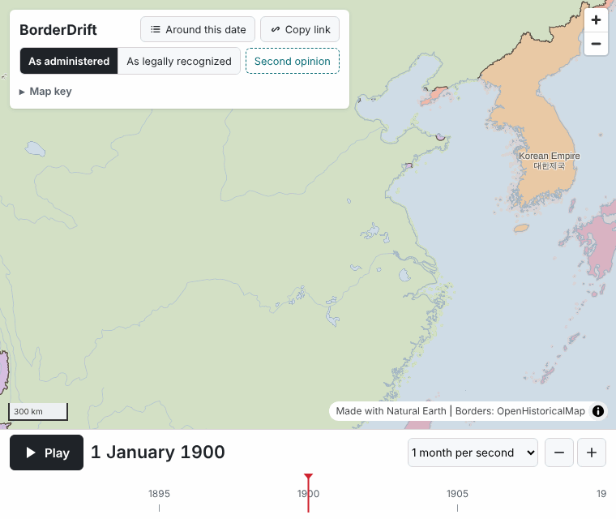

# BorderDrift

**Borders through time, with sources.** An open-source map of how the world's borders changed:
drag the timeline or press play, and every state, empire and colony redraws for that date. Every
border and event on the map is traced to a named source.

<p align="center">
  <a href="https://borderdrift-org.github.io/borderdrift/"></a>
</p>
<p align="center"><sub>East Asia, 1 January 1900 to 1 January 1950, one frame per year: borders as administered,
according to OpenHistoricalMap.</sub></p>

<p align="center"><b><a href="https://borderdrift-org.github.io/borderdrift/">Open the map →</a></b></p>

## What it does

- **A world map with a timeline** that zooms from thousands of years down to single days. Press
  play to watch the borders change.
- **Click a territory** to see what it was on that date: its names (in their own scripts too),
  who controlled it, who was legally recognized as its owner, its area, and the sources for each,
  with a button to report a problem.
- **Control and legal recognition are kept apart.** A switch shows borders as administered or as
  legally recognized, and a cross-hatch marks contested areas: administered by one state but
  legally recognized as another's. It never relies on color alone.
- **Events behind the changes,** marked on the timeline, each with a short summary and its
  sources. "Around this date" lists the events and border changes near the date you're on.
- **Honest about uncertainty.** A border whose dates are known only to the month or year is drawn
  lighter, and a second opinion from another dataset shows where sources differ.
- **Shareable links** to an exact date, place and selection, and it **works on phones.**

**Status: an early preview.** Detailed borders come from
[OpenHistoricalMap](https://www.openhistoricalmap.org/) for East Asia, 1900–1950; everywhere else,
from 3400 BCE to 2024, they're approximate and year by year, from
[Cliopatria](https://github.com/Seshat-Global-History-Databank/cliopatria). Legal borders come from
CShapes 2.0 (1886–2019). The current work is making the site ready to show people
([Phase 6 plan](docs/phase-6-plan.md)); everything done so far is in the
[roadmap](docs/architecture.md#roadmap).

## Principles

1. **Sources, never memory.** Every border, date, and event comes from a named source recorded in
   the data. Where we have no data, the map says so.
2. **Control, recognition, and claims are tracked separately.** Who actually ran an area, who was
   legally recognized as owning it, and what each source claims.
3. **Precision is recorded**, both for dates (exact day to rough century) and for borders (treaty
   line to frontier zone).
4. **We describe and attribute; we don't adjudicate.** Disputes are shown as disputes.
5. **Licenses are checked** before any data is imported (see [CREDITS.md](CREDITS.md)).
6. **Free to run:** a static site on GitHub Pages, with no paid services or API keys.

The full rules are in [CONTRIBUTING.md](CONTRIBUTING.md#ground-rules).

## Running it on your computer

You need [Git](https://git-scm.com/) and [Node.js](https://nodejs.org/) (the LTS version).

```bash
git clone https://github.com/borderdrift-org/borderdrift.git
cd borderdrift
npm install
npm run dev
```

Then open http://localhost:5173 in your browser. The page reloads automatically when you edit a
file. Stop the server with <kbd>Ctrl</kbd>+<kbd>C</kbd>.

| Command | What it does |
|---|---|
| `npm install` | Downloads the libraries the project uses into `node_modules/`. Run it once, and again after the dependencies change. |
| `npm run dev` | Starts a local development server with automatic reload |
| `npm run build` | Checks the code for type errors, then builds the published site into `dist/` |
| `npm run preview` | Serves the built `dist/` folder locally, exactly as it will be published |
| `npm run typecheck` | Only checks the code for type errors |
| `npm test` | Runs the automated tests once |
| `npm run test:watch` | Re-runs the tests every time you save a file |
| `npm run validate` | Checks every data file: format, references, dates, geometry, licenses |
| `npm run summarize-changes` | Describes, in words, what your copy of `data/` changes compared with `main` (records, borders, events, licenses, and what that does to contested areas and land areas). Pull requests get the same summary as a comment |
| `npm run suggest-crosswalk -- --region=W,S,E,N --years=FROM,TO --out=report.md --trial` | Suggests which CShapes units are the same state as Cliopatria's polities in a region and period, for the maintainers to review before contested areas are shown there (see `docs/crosswalk-review/`). Changes nothing in `data/` |
| `npm run measure-ohm` | Counts OpenHistoricalMap's country-level boundaries by region and period, to choose the next region to import. The "Measure OpenHistoricalMap's coverage" button in the Actions tab runs it on GitHub. Changes nothing in `data/` |
| `npm run record-demo` | Records the GIF at the top of this page (`docs/demo.gif`) from the site running locally (start `npm run dev` first). `-- --preview` makes the share preview image (`public/preview.png`) instead. The first time, run `npx playwright install chromium` |
| `npm run build-data` | Compiles `data/` into the files the site loads (`public/data/`); runs automatically before `dev` and `build` |
| `npm run import:ohm` | Re-imports the OpenHistoricalMap borders (see [data/imports/openhistoricalmap](data/imports/openhistoricalmap/README.md)) |
| `npm run import:cshapes` | Re-imports CShapes 2.0 from its pinned files (non-commercial; see [data/imports/cshapes-2-0](data/imports/cshapes-2-0/README.md)) |
| `npm run import:cliopatria` | Re-imports Cliopatria from its pinned release (see [data/imports/cliopatria](data/imports/cliopatria/README.md)) |
| `npm run import:natural-earth` | Re-downloads the Natural Earth base map from its pinned release (see [data/imports/natural-earth](data/imports/natural-earth/README.md)) |

The data format is documented in [docs/data-format.md](docs/data-format.md).

**Publishing** is automatic. Every push to `main` runs
[.github/workflows/deploy.yml](.github/workflows/deploy.yml), which builds the site and publishes
it to GitHub Pages. The same workflow builds every pull request as a check, without publishing it.
You can follow each run in the repository's **Actions** tab. Two more workflows help review:
[data-summary.yml](.github/workflows/data-summary.yml) posts the data-change summary on pull
requests, and [reimport.yml](.github/workflows/reimport.yml) is the "Re-import a dataset" button
(OpenHistoricalMap by default, or a pinned import).

## Contributing

Corrections are welcome, especially from people who know a region's history and sources well.
Because borders are politically sensitive, every change goes through a transparent, sourced review.
Read [CONTRIBUTING.md](CONTRIBUTING.md) to learn how to report a problem or propose a change, and
what counts as a source. To draw or fix a border, see
[docs/tracing-guide.md](docs/tracing-guide.md): borders are traced in OpenHistoricalMap from dated
public-domain maps, then imported. Reviewers: see [docs/reviewing.md](docs/reviewing.md). Everyone
taking part follows our
[Code of Conduct](CODE_OF_CONDUCT.md).

## Licenses

| What | License |
|---|---|
| Code | [MIT](LICENSE) |
| Data we create (borders, events, summaries, sourced assertions) | [CC0 1.0](data/LICENSE) (public domain dedication) |
| Third-party datasets in `data/imports/` | Their own licenses. See each folder's `LICENSE` and [CREDITS.md](CREDITS.md). **Some are non-commercial.** |
| Code of Conduct | Adapted from the Contributor Covenant 3.0 (CC BY-SA 4.0) |

## Design documents

- [docs/architecture.md](docs/architecture.md): how the site and data fit together, plus the
  roadmap and showcase plan.
- [docs/data-sources.md](docs/data-sources.md): the evaluation of each dataset (coverage,
  precision, format, license), including statistics datasets.
- [docs/phase-2-plan.md](docs/phase-2-plan.md): the plan for Phase 2 (approved 2026-09-27),
  with progress and open questions.
- [docs/phase-3-plan.md](docs/phase-3-plan.md): the plan for Phase 3, contested and uncertain
  borders (approved 2026-09-28), with progress.
- [docs/phase-4-plan.md](docs/phase-4-plan.md): the plan for Phase 4, the contribution pipeline
  (approved 2026-09-28), with progress.
- [docs/phase-5-plan.md](docs/phase-5-plan.md): the plan for Phase 5, the worldwide map
  (approved 2026-09-28), with measurements and progress.
- [docs/phase-6-plan.md](docs/phase-6-plan.md): the plan for Phase 6, a map good to use and good
  to watch (a draft; its first steps approved 2026-11-20).
- [docs/reviewing.md](docs/reviewing.md): how to review a pull request, merge it without a time
  zone stamp, and set up the repository's settings.
- [docs/tracing-guide.md](docs/tracing-guide.md): how to trace a border in OpenHistoricalMap
  from a dated public-domain map so that our import picks it up.
